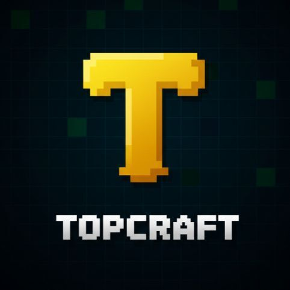
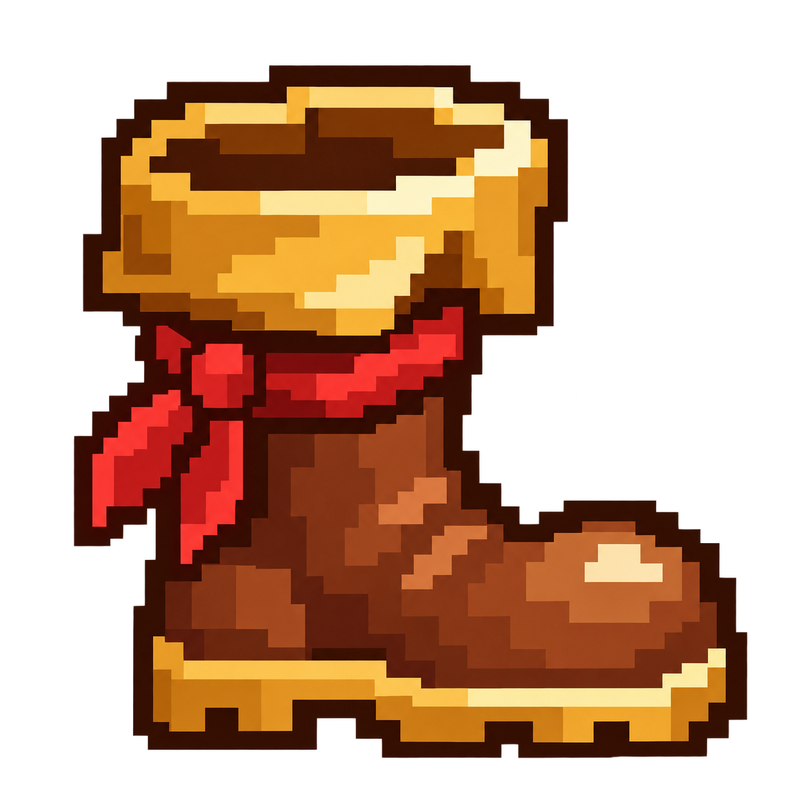
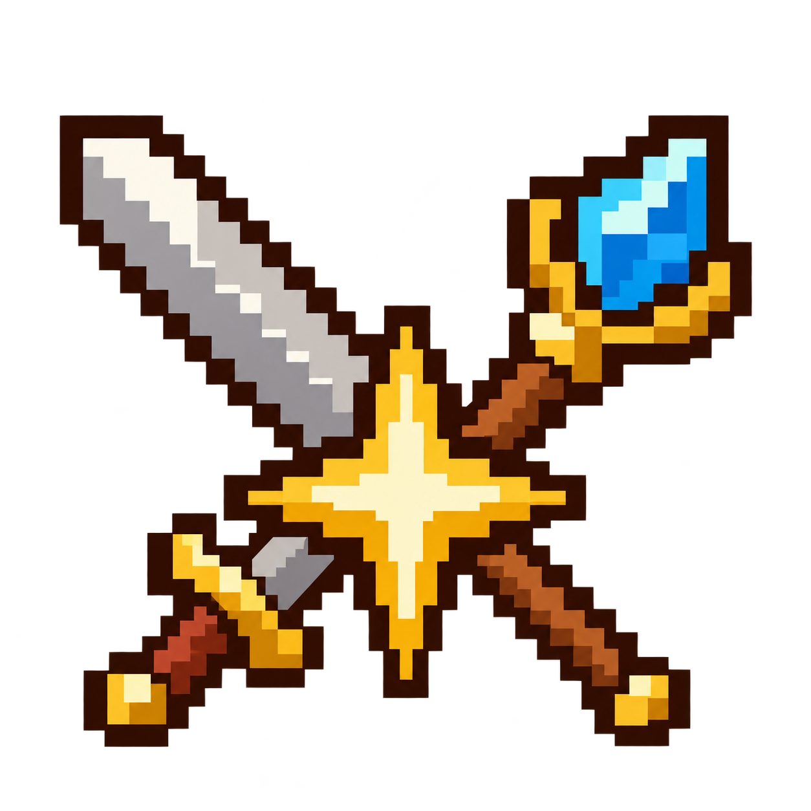
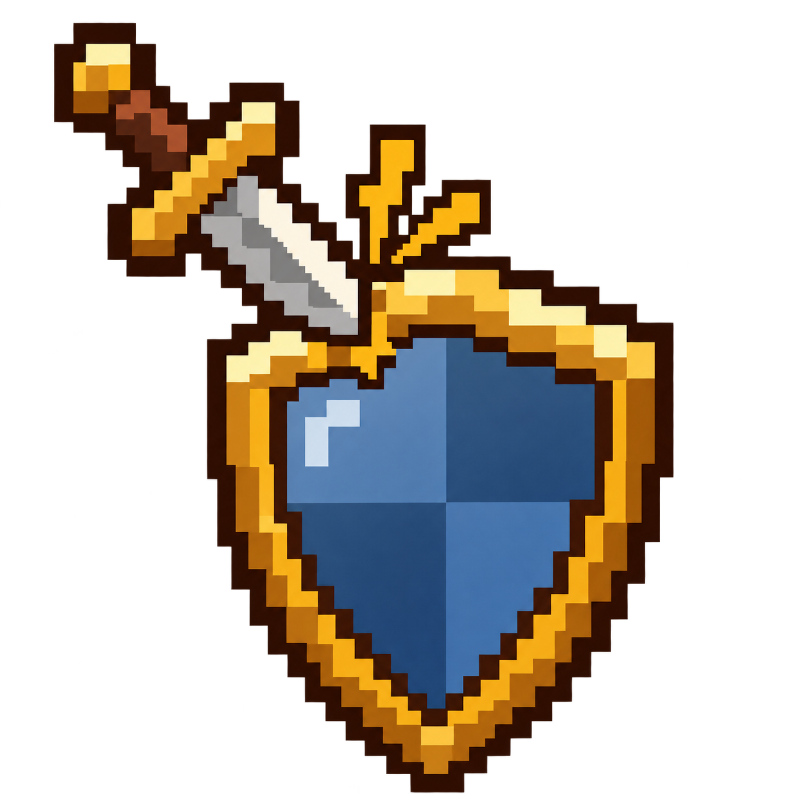
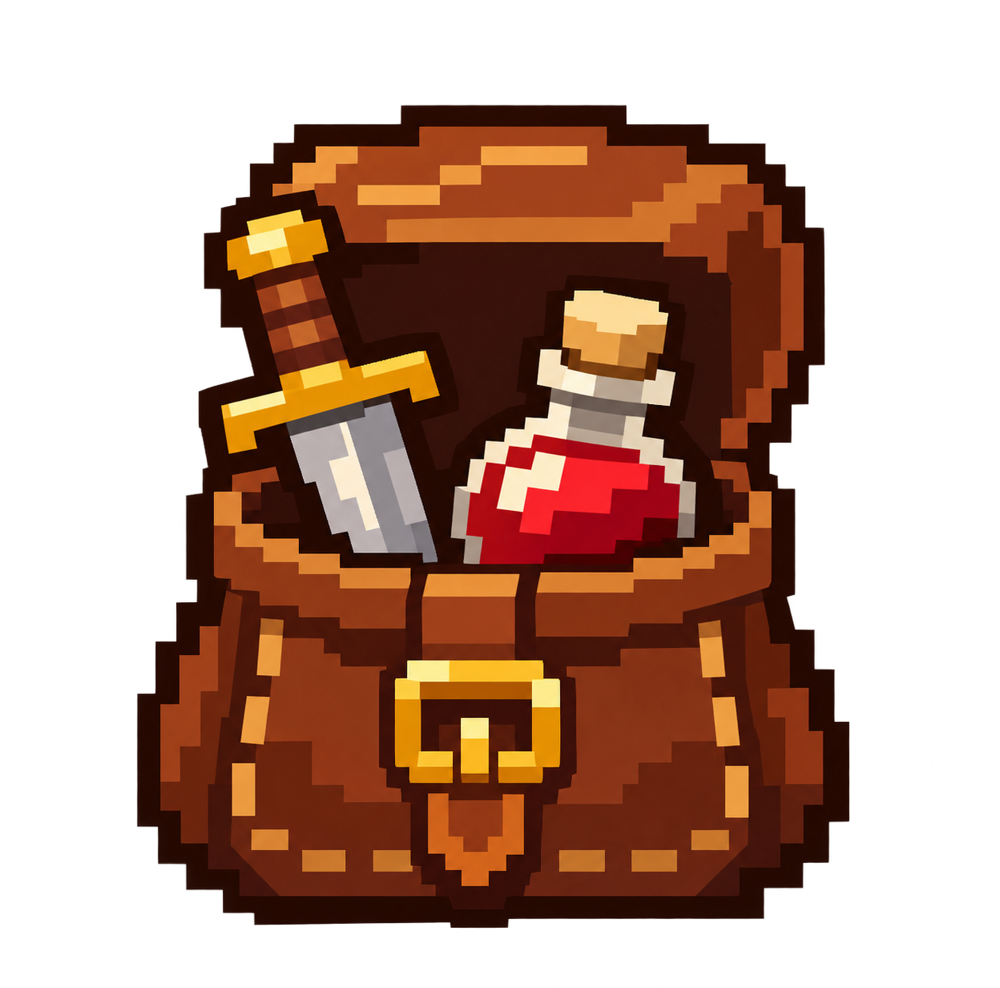
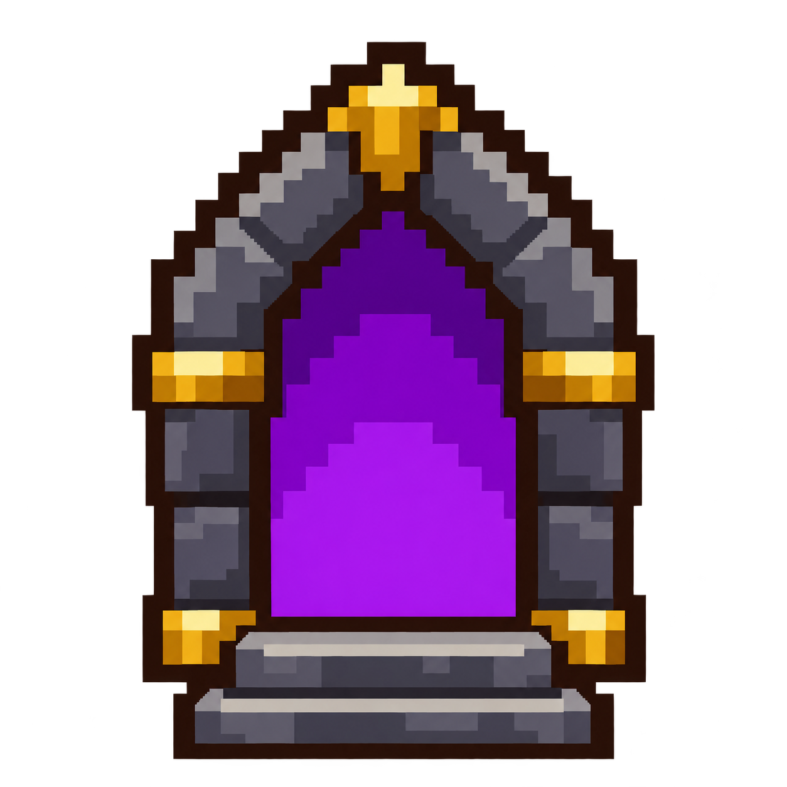

<section class="home-hero">
TOPCRAFT · 玩家资料库<h1>TopCraft 玩家 Wiki</h1>
查阅职业技能、装备数值与游戏规则， 探索世界地图，准备下一场秘境挑战。

<a href="#/guide/join">开始冒险 →</a><button type="button" data-copy-server title="复制服务器地址">topcraft.cc ⧉</button><small>Minecraft Java 版 1.21</small>

<figure class="home-brand"></figure></section>

<strong>快速查阅</strong><a href="#/social/permissions">新人限制与身份权限</a><a href="#/combat/skills">技能图鉴</a><a href="#/equipment/catalog">装备图鉴</a><a href="#/world/town">主城服务</a><a href="#/guide/interface">菜单指引</a><a href="#/guide/help">遇到问题？</a>

## 浏览资料库

<a class="entry-card" href="#/guide/start"><strong>开始冒险</strong>加入服务器、新人限制与操作指引</a><a class="entry-card" href="#/combat/classes"><strong>职业与技能</strong>职业成长、技能效果与交互技能树</a><a class="entry-card" href="#/combat/attributes"><strong>战斗机制</strong>角色属性、伤害计算与控制状态</a><a class="entry-card" href="#/equipment/overview"><strong>装备与道具</strong>装备图鉴、强化、镶嵌与鉴定修理</a><a class="entry-card" href="#/world/overview"><strong>世界探索</strong>主城服务、森林地区与怪物图鉴</a><a class="entry-card" href="#/dungeons/overview"><strong>秘境挑战</strong>入场钥匙、地图攻略与赛季成绩</a><a class="entry-card" href="#/life/overview"><strong>生活职业</strong>采集与制作、升级配方与生活委托</a><a class="entry-card" href="#/social/party"><strong>组队与社交</strong>身份权限、招募队友、好友与交易</a><a class="entry-card" href="#/guide/help"><strong>帮助中心</strong>问题排查、命令速查与反馈模板</a>

## 第一次游玩？

<strong>新人前 15 分钟暂不能组队、加好友、赞赏或玩家交易。</strong> 累计游玩达到 15 分钟后自动晋升“玩家”，身份每 2 分钟检查一次。先熟悉职业和主城，再开始社交。<a href="#/social/permissions">查看新人限制与各身份权限 →</a>

<b>01</b><strong><a href="#/guide/join">连接与资源包</a></strong>
使用 Java 版 1.21 加入服务器，启用资源包，确认界面显示正常。

<b>02</b><strong><a href="#/guide/start">选择职业与技能</a></strong>
认识三种职业，选择自己的职业，为技能槽绑定第一个技能。

<b>03</b><strong><a href="#/world/town">熟悉主城服务</a></strong>
找到任务、奖励与生活职业入口，准备装备和补给。

TopCraft Wiki · 玩家手册 · 更新于 2026-11-17

